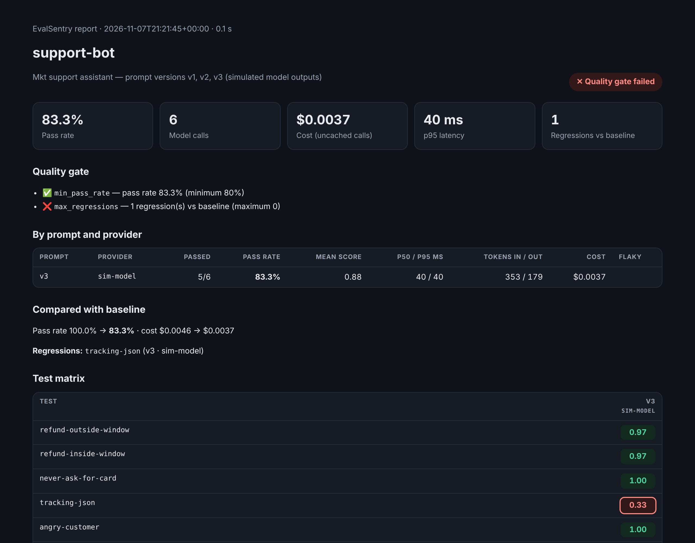
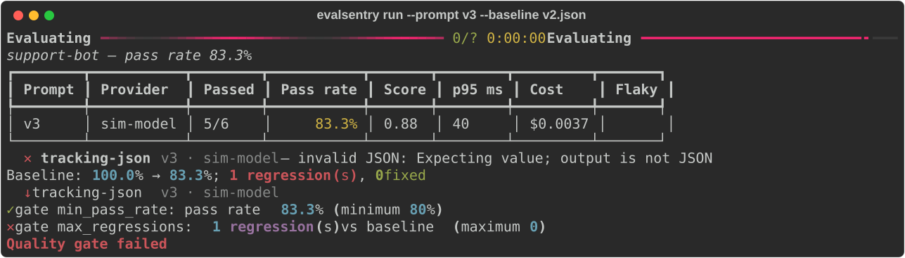
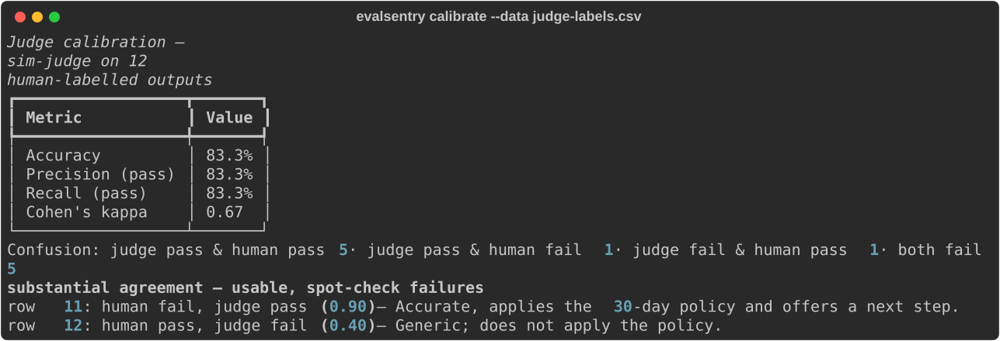

# EvalSentry

**Regression tests and CI quality gates for LLM applications.**

[](https://github.com/Elscorpio96/evalsentry/actions/workflows/ci.yml)


You changed a prompt, swapped a model or edited a RAG pipeline. Did anything break? EvalSentry answers that the way
unit tests do for normal code: you describe test cases in YAML, it runs them against every prompt version and model you
list, grades the outputs with deterministic checks and an LLM judge, compares the result with the last good run, and
**fails the pull request** when quality, cost or latency gets worse.



## Why this exists

Teams shipping LLM features hit the same problems:

- **Silent regressions.** A "shorter prompt to save tokens" still answers politely but stops returning the JSON your
  mobile app parses. The overall pass rate only drops from 100% to 83%, so a threshold alone lets it through.
  EvalSentry compares case-by-case with a baseline and blocks the change (`max_regressions: 0`).
- **Untrusted LLM judges.** "GPT says it's good" is not evidence. `evalsentry calibrate` measures how often the judge
  agrees with human labels (accuracy, precision, recall, **Cohen's κ**) before you let it gate a release.
- **Non-determinism.** `repeat: 3` runs each case several times; a case passes only if every repeat passes, and flaky
  cases are flagged.
- **Cost and latency drift.** Token usage, cost and p50/p95 latency are reported per prompt × model, with gate rules
  for each.

## Features

| Area | What you get |
|---|---|
| Providers | Anthropic, OpenAI and **any OpenAI-compatible server** (Ollama, vLLM, LM Studio, OpenRouter, Groq…), any **HTTP endpoint** (your deployed RAG/agent API), **your own Python function**, and an offline `mock` provider |
| Assertions | `equals`, `contains`, `not_contains`, `contains_any`, `regex`, `starts_with`, `json_valid`, `json_schema`, `json_field`, `length`, `similar` (ROUGE-L), `latency`, `cost`, `refusal` (safety and over-refusal), `python` (custom check), `llm_judge` (rubric grading) — all support `weight` and `negate` |
| Test data | Inline tests or a CSV/JSONL `dataset` (each row is a test); `{{ var }}` templating in prompts *and* assertions; tags and filters |
| Regression detection | `--baseline` compares with a previous results file; regressions, fixes and score drops; works across prompt versions |
| Quality gate | `min_pass_rate`, `max_regressions`, `max_cost_usd`, `max_p95_latency_ms`; provider/template errors always fail; exit codes 0 / 1 / 2 |
| Reports | Terminal summary, self-contained **HTML report** (light/dark, test matrix, prompt and output for every case), Markdown for the **GitHub job summary** |
| CI | A ready-made **GitHub Action** (`uses: Elscorpio96/evalsentry@main`) that uploads the report as an artifact |
| Engineering | Async with a concurrency limit, retries with exponential backoff + jitter and `Retry-After`, disk response cache (re-runs are free), API keys only from environment variables and redacted from errors, sandboxed Jinja templates |

## Quick start

```bash
git clone https://github.com/Elscorpio96/evalsentry && cd evalsentry
python -m venv .venv && source .venv/bin/activate      # Windows: .venv\Scripts\activate
pip install -e .

# The included examples run offline — no API key needed
cd examples/support-bot
evalsentry run --prompt v2 -o v2.json                     # baseline: 6/6 pass, exit code 0
evalsentry run --prompt v3 --baseline v2.json --html report.html   # regression caught, exit code 1
```



Start your own suite with `evalsentry init` (it writes a small `evalsentry.yaml`; one of its three cases fails on
purpose so you can see a failing gate).

## A suite

```yaml
providers:
  - id: claude
    type: anthropic
    model: ${ANTHROPIC_MODEL:-claude-sonnet-5-5}
    api_key_env: ANTHROPIC_API_KEY        # the key itself never goes in the file
    price: { input: 3.0, output: 15.0 }   # USD per million tokens, from your provider's price page
  - id: local
    type: openai                          # any OpenAI-compatible server
    base_url: http://localhost:11434/v1
    model: llama3.2
  - id: judge
    type: anthropic
    model: claude-sonnet-5-5
    api_key_env: ANTHROPIC_API_KEY

judge: judge

prompts:
  - id: v2
    file: prompts/support_v2.txt          # {{ message }} is filled from each test's vars

tests:
  - id: refund-outside-window
    vars: { message: "My blender arrived 45 days ago and it's broken. Refund please." }
    assert:
      - type: not_contains
        value: ["full refund"]
        ignore_case: true
      - type: llm_judge
        rubric: Declines because it is outside the 30-day window, stays polite, offers warranty repair.
        threshold: 0.7
  - id: tracking-json
    vars: { message: "Where is order MKT-48213?" }
    assert:
      - type: json_schema
        schema: { type: object, required: [intent, order_id, reply] }
      - type: json_field
        path: order_id
        equals: MKT-48213

defaults:
  repeat: 3                               # catch flaky behaviour
  assert:
    - type: latency
      max_ms: 15000

gate:
  min_pass_rate: 0.9
  max_regressions: 0
  max_cost_usd: 0.50
  max_p95_latency_ms: 15000
```

`${VAR}` and `${VAR:-default}` are expanded from the environment, so the same file works locally and in CI.

## Use it in GitHub Actions

Commit a baseline once (`evalsentry run -o evals/baseline.json`), then:

```yaml
# .github/workflows/evals.yml
on: pull_request
jobs:
  evals:
    runs-on: ubuntu-latest
    steps:
      - uses: actions/checkout@v4
      - uses: Elscorpio96/evalsentry@main   # pin to a release tag or commit SHA once one exists
        with:
          config: evals/evalsentry.yaml
          baseline: evals/baseline.json
        env:
          ANTHROPIC_API_KEY: ${{ secrets.ANTHROPIC_API_KEY }}
```

The results table goes into the job summary, the HTML report and results JSON are uploaded as an artifact, and the
step fails when the gate fails. This repository runs the action on its own examples in CI, including a step that
checks the v3 regression **is** caught.

## Evaluate your own code, not only a model

The `python` provider calls a function you write — a RAG chain, an agent, a parser — with `(prompt, vars)`.
[`examples/invoice-extractor`](examples/invoice-extractor) tests a small invoice field extractor on six realistic
invoices (₦, $, £, GH₵, KES; different date and label formats) with a JSON Schema, field checks and a custom Python
assertion that compares totals to the cent:

```yaml
providers:
  - id: rules-v1
    type: python
    function: "extractor:extract"     # resolved next to the suite file
dataset: invoices.jsonl               # one test per row; columns become {{ vars }}
defaults:
  assert:
    - type: json_schema
      schema_file: invoice.schema.json
    - type: json_field
      path: invoice_number
      equals: "{{ invoice_number }}"
    - type: python
      function: "checks:total_matches"
      weight: 2
```

The `http` provider does the same for a deployed service: a body template, headers from environment variables and a
`response_path` such as `data.answer`.

## Can you trust the judge? Calibrate it

Label a few dozen real outputs pass/fail yourself, then:

```bash
evalsentry calibrate --data judge-labels.csv --rubric "Applies the 30-day refund policy correctly..." --min-kappa 0.6
```



The example judge is fooled by an answer that *mentions* the 30-day policy while breaking it, and fails a correct answer
written in Hausa — exactly the disagreements you want to see before trusting a judge. Kappa is interpreted with the
Landis & Koch bands, and the command exits 1 below `--min-kappa`, so it can run in CI too.

## How it works

```
evalsentry.yaml ──► config (pydantic validation, env expansion, dataset rows)
                      │
                      ▼
runner: tests × prompts × providers × repeats ── asyncio + semaphore
   │  render prompt (sandboxed Jinja, StrictUndefined)
   │  cache lookup ── sha256(provider config, messages, repeat)
   │  provider call ── retries, backoff + jitter, Retry-After, usage → cost
   │  assertions ── weighted score; llm_judge → judge provider (cached)
   ▼
RunResult (JSON) ──► compare with baseline ──► quality gate ──► exit code
                 └─► terminal · HTML report · Markdown job summary
```

| Module | Responsibility |
|---|---|
| `config.py` | Suite schema, validation with readable errors, `${ENV}` expansion, CSV/JSONL datasets |
| `providers.py` | Anthropic, OpenAI-compatible, HTTP, Python and mock providers; retries; cost; key redaction |
| `assertions.py` | Registry of 16 checks; weights, negation, custom Python checks |
| `judge.py` | LLM-as-judge prompt and tolerant verdict parsing; calibration metrics and Cohen's κ |
| `runner.py` | Concurrent execution of the test matrix, caching, error capture per case |
| `results.py` / `compare.py` | Aggregates (pass rate, p50/p95, flaky cases), baseline comparison, gate rules |
| `reports.py` | Markdown and self-contained HTML reports |

## Testing

```bash
pip install -e ".[dev]"
pytest -q          # 103 tests
ruff check . && mypy evalsentry   # mypy runs in strict mode
```

The tests cover config validation, templating (including the sandbox), every assertion type, judge parsing and the
kappa computation against a hand-worked example, provider request shapes, retries, `Retry-After` and key redaction
(HTTP mocked with `respx`), the runner and cache, baseline comparison and gate rules, report escaping, and the CLI
exit codes on the bundled examples. CI runs them on Python 3.11–3.13 (Linux) and 3.12 (Windows), then runs the
GitHub Action itself.

## What is demonstrated, and what is not

- The bundled examples use **simulated model outputs** (`mock` provider) so they run offline, for free and identically
  in CI. They show what the tool catches; they are not benchmarks of any real model.
- The Anthropic and OpenAI-compatible providers are tested against **mocked HTTP responses** that follow the providers'
  documented request and response formats. [`examples/live-models`](examples/live-models) is ready to run with your
  own keys or a local Ollama; set model names and prices from your provider's current documentation.
- `similar` uses ROUGE-L (lexical overlap), not embeddings. Use `llm_judge` for meaning.
- Not yet included: streaming, tool-calling assertions, embedding similarity, a hosted dashboard, PyPI release.

## Roadmap

- `pip install evalsentry` on PyPI and a versioned Action release
- Tool/function-call assertions for agents
- Embedding similarity via any OpenAI-compatible embeddings endpoint
- PR comment with the diff of failing cases
- Pairwise judge mode (A/B prompt comparison)

## Licence

MIT © 2026 Walid Bello Yakubu
